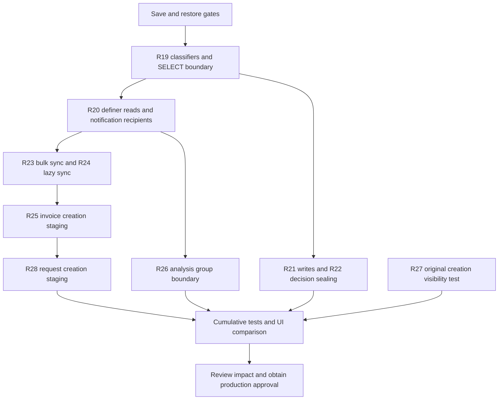

# R29 — R19–28 rollout and recovery gate map

**Decision: source candidates are verified in isolated fixtures; production rollout is NOT authorized or completed.** This document consolidates dependency and operational gates only. It changes no SQL, schema, user, policy, setting, data or payroll calculation. The detailed source contracts and fixture limitations remain in the existing r19–r28 catalog/candidate/review files; this is not a substitute for them.

## Evidence boundary

Frozen cumulative source checkpoint: R28 PR #1202, `32e7ed6955cdbd4bf808fb033f7515fbd8f50eb3`. Run 39001044779: PGlite job 117303829729 passes R28 47 cases; actual PostgreSQL 17/PostgREST job 117303829604 passes R28 52 cases. Both execute the retained R19–27 chain. Independent R28 source review is conditional PASS. These results concern disposable fixtures, not production GoTrue/provider/iPhone behavior. Newer integration commits require their own CI; old head evidence cannot be relabeled as new-head evidence.

No production DML/DDL or business-row retrieval was performed for this preparation. Actual production definitions were sampled as catalog metadata at earlier checkpoints and saved in the relevant catalogs. They are historical evidence, not proof that the live database still matches. Git integration of review-only files does not apply them to Supabase.

## Dependency map

The arrows show semantic prerequisites. The **tested execution order is R19 → R20 → R21 → R22 → R23 → R24 → R25 → R26 → R27 verification → R28**. R27 adds no product patch. Do not infer that intermediate production states are safe: original candidates each contain their own BEGIN/COMMIT. They are not a ready-made atomic deployment bundle. A separately reviewed execution/rollback plan must prevent normal use of partially secured LINE paths until the complete required boundary is committed and verified. No temporary role flip, user lockout or feature-data reset is authorized by this document.

## Per-stage contract and saved recovery material

| Stage | Exact prerequisites to recheck before rollout | Change and recovery unit | Verification / remaining gap |
|---|---|---|---|
| R19 | Existing RLS on invoices, groups, notes, albums/items, correction requests/items, notifications and storage.objects; authoritative private lineage tables; enabled Master registry; account-access and UUID helpers; no conflicting r19 names | New private classifiers and restrictive SELECT policies only; retain every original policy, table ACL, function ACL/owner/config and lineage constraints | Known linked SELECT hidden from non-Master; existing permissive policy inventory and authoritative lineage completeness must be rechecked |
| R20 | R19 helpers and five exact original definer source hashes in r20 candidate/catalog, owners and callable wrappers | Replaced invoice history/status/status-v2, trade-document source and notification enqueue definitions; new private linked-notice helper | Selected definer reads and ordinary-recipient suppression tested; existing stored notices/push/caches are not recalled |
| R21 | R19 helpers; invoice and communication RLS; exact two approval function source contracts | Restrictive ALL policies for selected invoice/group/note/album surfaces and entry guards on approval RPCs; preserve ordinary ACL/owner/config | Selected writes/approval tested; SECURITY DEFINER writers outside enumerated targets require inventory |
| R22 | Exact original decide_attendance_correction_request source and R19 request helper | Request decision entry guard; preserve original decision/calculation body | Non-Master linked decisions denied; linked publication sealed even for Master/NULL decision; ordinary decisions/numerics retained. Private Master approval is not supplied |
| R23 | Exact set_invoice_approvers original contract; R19 invoice helper | Five-anchor filter excludes known linked invoices from company bulk synchronization, including Master actions | Ordinary company settings remain usable; does not by itself close lazy sync or creation-before-lineage |
| R24 | Exact ensure_invoice_approval_rows original source plus durable lineage tables | Known-linked lazy sync short-circuit; keep actual original invoice creation trigger definitions for restore/order checks | Initial creation leak reproduced; staging in R25 is required to close the tested window |
| R25 | R19/R20/R24 staged hashes, original two LINE creation source hashes, unchanged invoice trigger and FK inventory; no conflicting private registry | Private invoice staging registry; classifier/enqueue/lazy helper and two LINE creation guards; preserve original validation/receipt/hash/numeric logic | Actual creation+trigger ordering tested. Master-private approval rows are not silently populated from ordinary company settings |
| R26 | Exact account_access_allowed source MD5 `aeca25db212c043c472334026bd98724`, account restriction table, exact eight function contracts and RLS on messages/attachment metadata/members | Restrictive ALL policies, access/member/invite/respond/list/notice classifier patches | Moderator permissive SELECT and old stored invite notice reads covered; real Storage delivery and already-delivered content remain separate |
| R27 | Exact original analysis creation/custom creation sources and three original group triggers; zero noninternal member triggers at checkpoint | Test-only evidence, no extra product registry or pending patch | Pre-lineage creator-only/participants-only path verified. New triggers/writers invalidate this bounded conclusion |
| R28 | Exact ordinary submit MD5 `3b8a6b1d701c110910f8f6c0cc6bd0db`, original LINE wrapper MD5 `fbfe8412eae55abb32a95777ec5b5e1d`, staged R19/R20 helpers and original request/item trigger/FK inventory | Private tx/backend actor/company context; new BEFORE request INSERT trigger; request/item restrictive ALL; three staged source patches. Ordinary submit source remains byte-identical | Before-lineage ordinary notification reproduced and sealed; no-context ordinary behavior retained. Global trigger, multiple live triggers/order, real UI and concurrent separate connections need further checks |

All exact signatures, expected source hashes and anchors remain in each `rNN_candidate.sql.review-only`; they must match the live **stage input**, not only the initial database. Capture the output definition/owner/ACL/config after every staged patch in the isolated rehearsal. No blanket hash bypass or fallback text replacement is permitted if drift is found.

## Mandatory save and isolated recovery checklist

Every checkbox below is **pending for full production rollout** unless fresh evidence is attached. Earlier partial two-table local restoration does not satisfy full DB/Auth/ACL recovery.

- [ ] Freeze the chosen Git commit and record clean/dirty/untracked/ignored native-source state without deleting or stashing over user changes. Preserve the original Mac worktree and saved iOS/signing assets separately; do not publish secrets.
- [ ] Save complete required database schema and data privately, plus role/table/schema privileges, RLS policies including permissive/restrictive mode and role lists, function definitions/owners/ACL/config/default privileges, triggers/order, constraints/FKs, extension versions and relevant publication/Storage configuration. Record tool/server versions and backup hashes without logging private contents.
- [ ] Save protected administrator identities, enabled Master entries, company membership/role linkage, account restrictions, login identities and trusted-device/recovery settings with controlled access. Do not alter IDs, OAuth providers, company links or passwords as part of boundary deployment.
- [ ] Save Auth/provider/config and Edge Function versions/config references needed for recovery. A SQL dump alone is not complete GoTrue/Auth/Edge/Storage-object recovery. Keep credential values outside Git/PR/logs and do not request users paste them into chat.
- [ ] Restore the intended backup into a fully isolated environment with no outbound production connections, push/email delivery or production Storage writes. Verify backup completeness and object/data/privilege parity using private evidence.
- [ ] Restore original administrator/company/role and legitimate access behavior; compare Master, admin, subadmin/delegated manager, viewer/general and cross-company/anonymous denial. Verify ordinary invoice, attendance and company sharing paths do not disappear.
- [ ] Apply the exact staged candidates only to that restored environment, enforce all drift guards, then execute cumulative SQL/HTTP and normal UI tests. Include R28 global trigger ordering and concurrent backend/transaction mismatch tests against the restored real trigger inventory.
- [ ] Revert the entire proposed staged change in isolation using saved original definitions, policy/ACL catalog and explicit object ownership. Verify identical admin/company/role/data snapshots and restored normal behavior. Do not drop the staging tables/helpers while patched functions/triggers still reference them.
- [ ] Record a bounded rollback stop condition, operator, private artifact locations, expected maximum interruption and escalation path. Full recovery duration is measured, not assumed.

## Approval and execution gate

- [ ] Give the user the exact commit, SQL object changes, affected LINE-only paths, ordinary-path comparisons, expected interruption and tested rollback outcome; obtain explicit approval for that concrete production change.
- [ ] Re-read live metadata only immediately before change; compare with saved stage contracts and the rehearsed inventory. Any new source, trigger, policy, owner, grant, role or company-membership drift stops rollout for review.
- [ ] Perform only the approved database changes; no business-data migration/deletion, automatic legacy cleanup, role reassignment or authentication reset. Verify the full boundary before allowing relevant LINE operations.
- [ ] Validate normal administrator access and ordinary work first, then anonymous/cross-company/non-Master negative cases. Match post-state catalogs to approved output and preserve evidence privately.
- [ ] If a guard/test fails, stop the remaining changes and follow the rehearsed rollback plan. Never broadly disable RLS or elevate ordinary users to recover availability.
- [ ] Separately verify Release/TestFlight artifact SHA, signature, Bundle ID/version/hash/entitlements and auth/device/logout/relogin behavior. Successful SQL fixtures do not authorize app distribution.

## Explicit non-completion conditions

1. **Unknown provenance:** current classifiers identify records with authoritative private lineage (plus controlled in-transaction staging), not every historical copy. Unclassified/copied ordinary invoices, attendance, chat, files or exported documents require a separately approved provenance investigation; no title/prefix heuristic may grant or revoke access.
2. **Already-delivered data:** old cached/push/email/download/printed documents and external signed URLs are not erased or recalled by a new SELECT policy. Real Storage authorization/revocation/expiry, public bucket exposure and cache lifetime require separate validation.
3. **Master-private approval:** suppressing ordinary company approvers is deliberate protection, not a completed private approval workflow. Do not invent self-approval, silently reuse company recipients or publish private LINE attendance into normal business tables. A separate explicit workflow decision and implementation remain required.
4. **Unenumerated writers:** source/trigger inventories at checkpoints are bounded. New RPCs, service-role jobs, imports, custom function callbacks and future migrations must be checked; RLS does not constrain a privileged definer automatically.
5. **Full restore and production state:** fixture definition restoration proves selected candidate rollback only. No assertion is made that full production recovery, production application, real provider authentication, all role UI comparisons or iPhone testing has completed.

This map consolidates rollout planning without changing the existing completion ledger or pretending isolated source work is deployed security.
